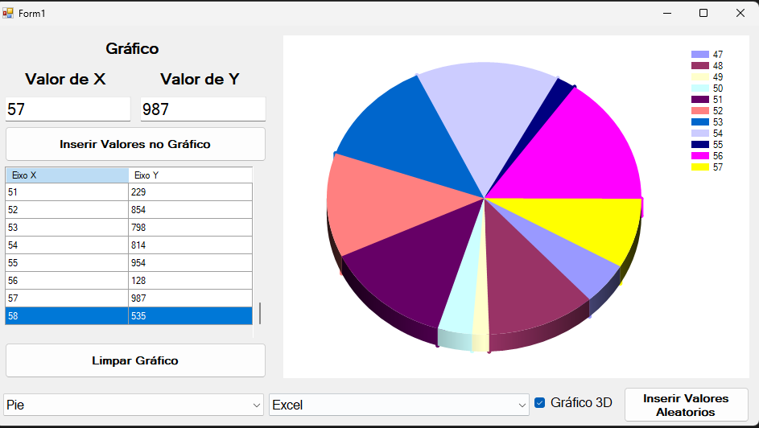

# Gráficos Interativos — C# Windows Forms

Aplicação desktop desenvolvida em **C# e Windows Forms** para criação, visualização e personalização de gráficos a partir de valores numéricos.

O projeto foi desenvolvido para praticar conceitos de programação em C#, manipulação de coleções, LINQ, eventos e componentes visuais do Windows Forms.

## Demonstração

## Funcionalidades

- Inserção manual de valores para os eixos X e Y.
- Visualização dos dados em uma tabela (DataGridView).
- Geração de diferentes tipos de gráficos.
- Personalização das paletas de cores.
- Ativação e desativação da visualização em 3D.
- Geração automática de valores aleatórios utilizando Timer.
- Ordenação dos valores utilizando LINQ.
- Atualização de valores existentes.
- Limpeza dos dados e do gráfico.
- Validação básica dos campos de entrada.

## Tecnologias utilizadas

- C#
- .NET Framework
- Windows Forms
- LINQ
- Dictionary
- Chart Controls
- Visual Studio

## Como executar

1. Faça o download ou clone este repositório.
2. Abra o arquivo `Graficos.sln` no Visual Studio.
3. Restaure as dependências, caso necessário.
4. Compile e execute o projeto utilizando `F5`.

## Objetivo do projeto

Desenvolver conhecimentos práticos em aplicações desktop, trabalhando com eventos, estruturas de dados, manipulação de informações e representação visual por meio de gráficos.

## Autor

**Darlan Rosendo**

Desenvolvedor em constante aprendizado e aprimoramento de conhecimentos em C# e desenvolvimento de software.

GitHub: https://github.com/darlanrosendo
